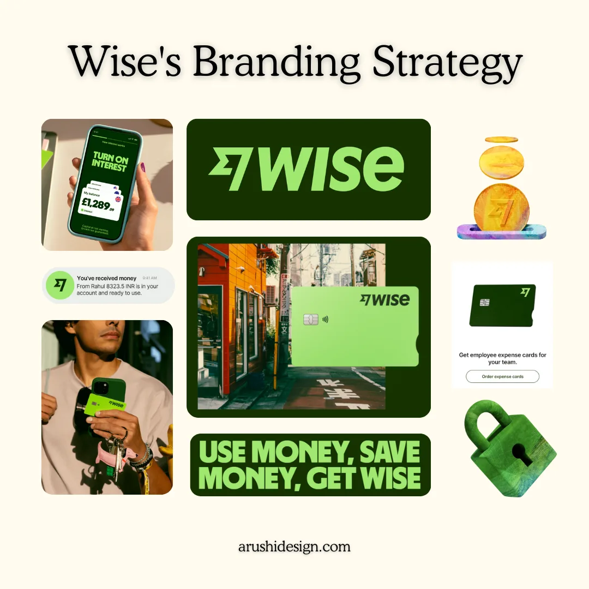
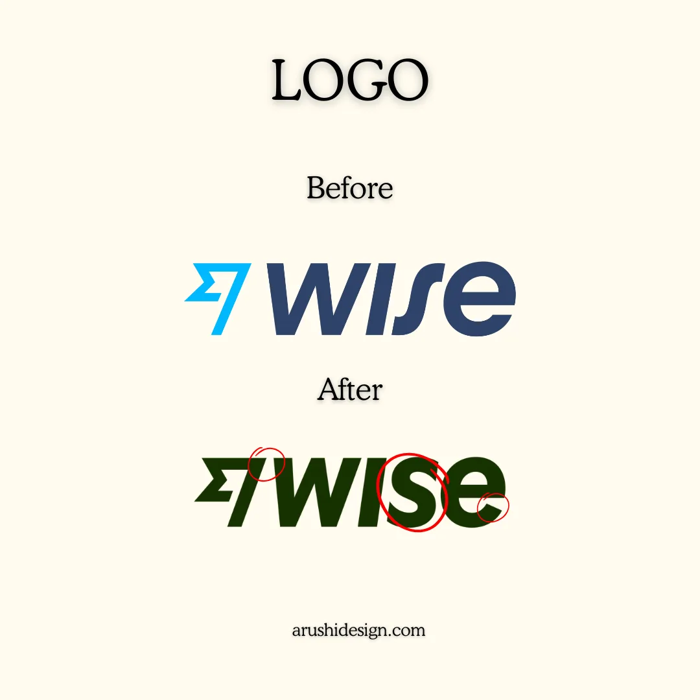
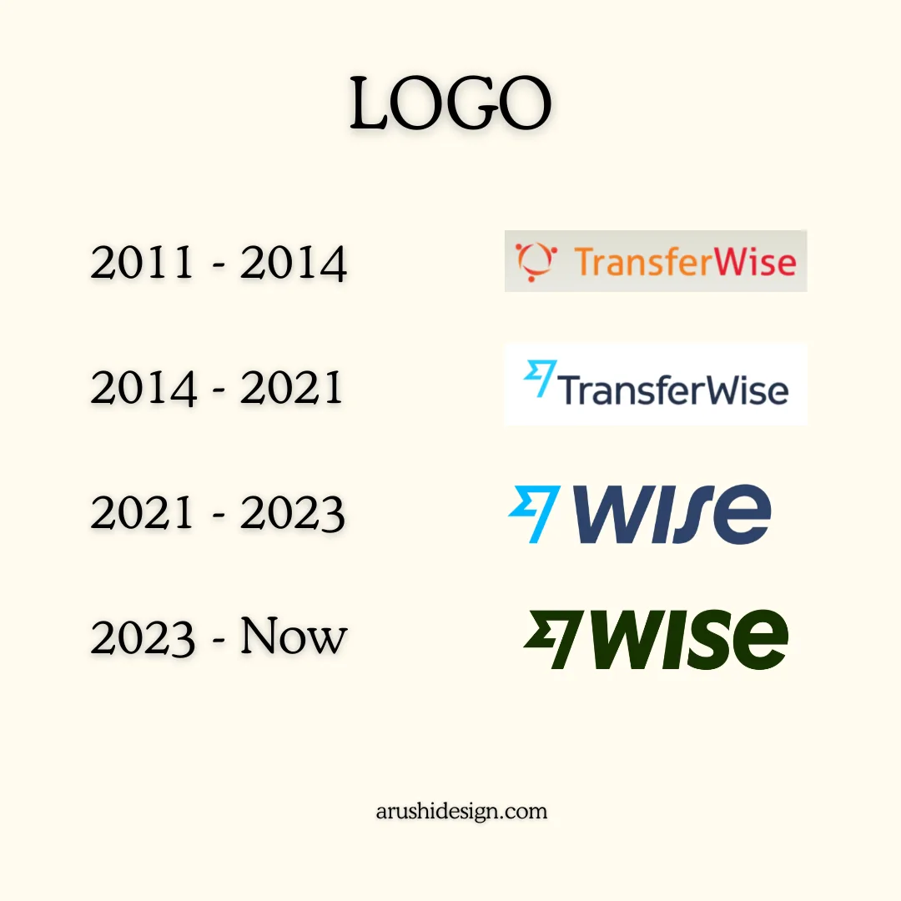
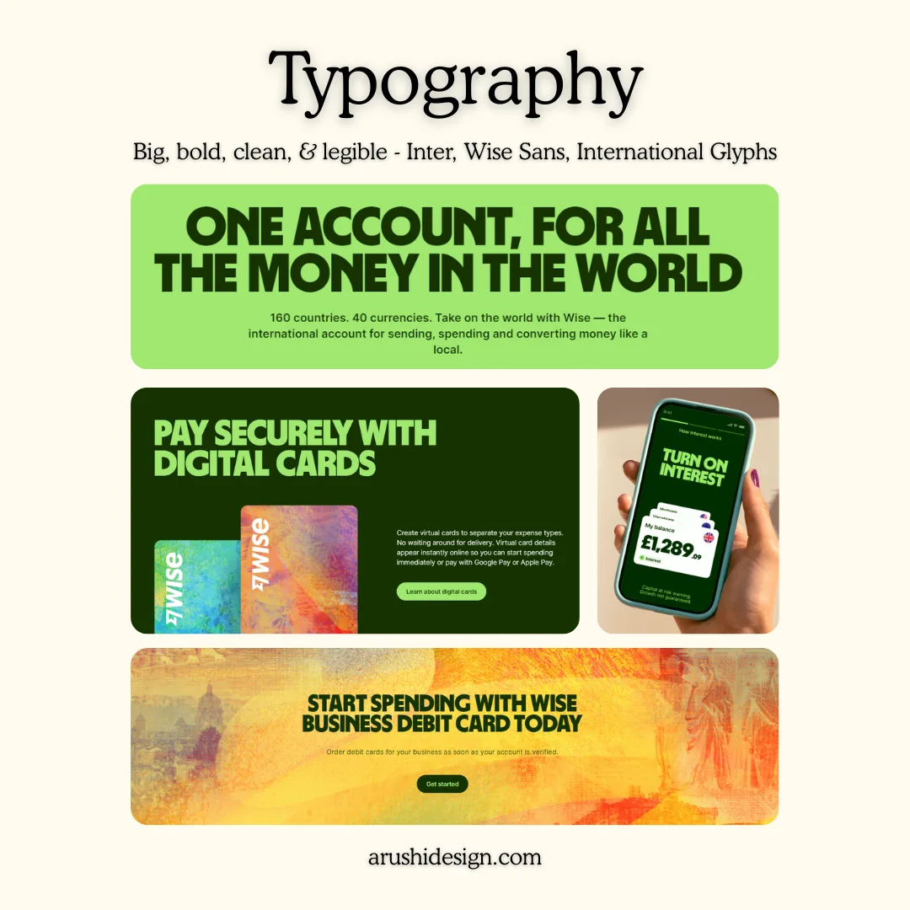
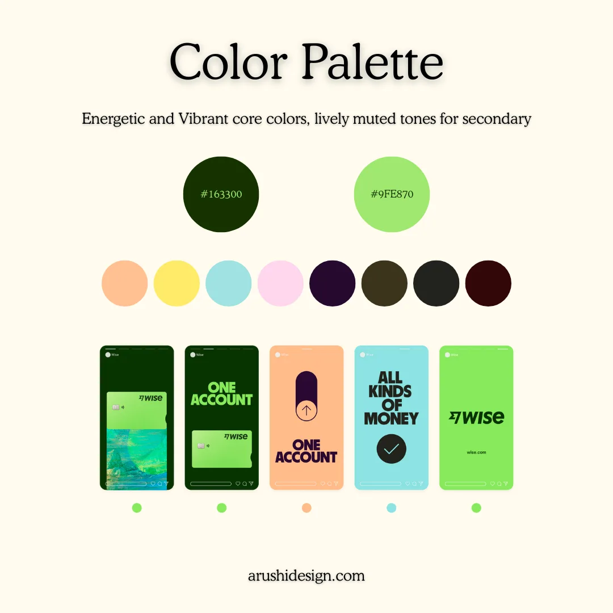
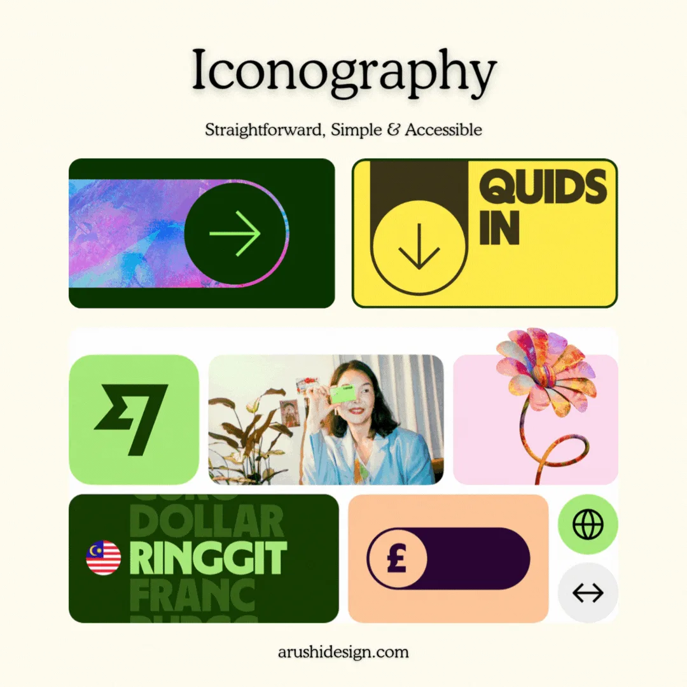

When 16 million customers trust you with their money, rebranding isn't just a visual refresh—it's a promise renewed.

Wise didn't just change its name. They reimagined what a global financial brand could be.

## The Big Idea: The World's Money

Working with London-based agency Ragged Edge, Wise landed on a concept that feels both simple and profound: **"The World's Money."**

It's the kind of idea that makes you nod slowly. Of course. Money that belongs to everyone, everywhere. Money that moves as freely as the people who use it. [A brand for people living multi-currency lives](https://www.khula.studio/blog-insights/a-wise-move-what-a-good-rebrand-looks-like) who need their finances to be as borderless as their ambitions.

This wasn't just a tagline—it became the North Star for every design decision that followed.

## The Challenge

Operating in 170 countries means speaking 170 different languages—literally and culturally. How do you create one brand that feels local everywhere?

## The Solution

Wise built their rebrand around one powerful idea: **"The World's Money"**

Not *our* money. Not *their* money. The world's money.

## Why the Change? When Your Name Becomes Too Small

Picture this: you start a company to solve one problem—sending money across borders without getting fleeced by banks. Twelve years later, you're offering multi-currency accounts, debit cards, business solutions, and an entire financial infrastructure. The name "TransferWise" suddenly feels like wearing shoes two sizes too small.

[Wise's Design Director Cameron Worboys](https://the-brandidentity.com/interview/how-the-ragged-edge-and-wise-teams-came-together-to-craft-a-pivotal-rebrand-for-the-worlds-money) put it: "We're on a journey to communicate 'who we are' and 'where we're going.' Showing the world we're so much more than transfers."

This is what we call a **strategic rebrand** —not a cosmetic refresh, but a fundamental repositioning. The company was shifting from a send-money service to an international digital account, and the brand needed to catch up with that reality.

## The Visual Language: Designed for Everyone, Everywhere

The rebrand's visual system is where "The World's Money" truly comes alive.

**The vibrant green** replaced fintech's conventional blue—a universal symbol of both money and progress that feels fresh and optimistic.

**Wise Sans**, the custom typeface, draws inspiration from scripts around the world—a 'B' from a sign in Davao City, Philippines; a 'G' influenced by Thai script; letterforms from Kerala, India. [The font supports 960 languages](https://raggededge.com/partnerships/wise/), making it genuinely global. One attendee at a Wise event recognized the exact Malayalam influence in the typography—that's authentic connection.

**The tapestries** —perhaps the most distinctive element—are graphic assets that weave together images, textures, and colors from places along Wise customers' most popular routes. They're based on actual coordinates on the globe, creating a visual language that feels both worldly and unmistakably Wise.

**The icons and illustrations** were obsessively designed for accessibility, exceeding WCAG 3.0 standards. Over 200 color combinations were tested. Every icon was drawn to ensure equal positive and negative space, so they remain clear for people with visual impairments.

This wasn't design for design's sake. Every choice served the mission: to be understood by everyone, everywhere.

## The Emotional Hook

Here's what most brands miss: Wise didn't just rebrand *for* their customers—they rebranded *with* them. Every color, symbol, and word celebrates the diverse, dynamic world that their users navigate daily.

[Wise's VP of Growth Nilan Peiris](https://medium.com/@igorbatko/growthstory-how-transferwise-is-building-a-new-global-financial-services-brand-96ec973a082e) explains: "Building trust in an industry that has systemically eroded it requires extremes. You have to go out and prove you are not trying to build another bank."

## What Kind of Rebrand Is This?

This is a **transformational rebrand** —the most comprehensive type. It touches everything:

- **Strategic repositioning**: From money transfer service to complete financial platform
- **Visual identity overhaul**: New logo, colors, typography, graphic system
- **Verbal identity refresh**: New tone, messaging, and brand voice
- **Product evolution**: Expanded offerings to match the new brand promise
- **Cultural alignment**: Internal teams restructured around the new vision

Unlike a simple refresh (updating colors or modernizing a logo), Wise rebuilt its brand from the foundation up while carefully preserving the equity in recognizable elements like the "Fast Flag" icon.

## What the Rebrand Achieved

The results speak in the language businesses understand best: numbers.

- **58% share price increase** in the 12 months after launch
- **10% jump in website conversions**
- **34% uplift** in new users adopting multi-product features
- **26% increase** in existing users trying additional products
- [Valuation nearly doubled](https://raggededge.com/partnerships/wise/) to $14.4 billion

But beyond metrics, the rebrand achieved something harder to quantify: it created a brand that feels genuinely different in a sea of sameness. In an industry where trust is currency, Wise built an identity that radiates transparency, accessibility, and global ambition.

## The Lesson

Great rebranding isn't about looking different. It's about becoming more of who you truly are—and inviting your audience to be part of that story.

When you're building for everyone, everywhere, your brand needs to feel like home to all of them. 🏡

*What's your favourite example of a rebrand done right? Share in the comments below!*

Image credits © Wise Official Website and [https://wise.design/](https://wise.design/)

Overview and Comparison graphics designed by Arushi Design Studio
