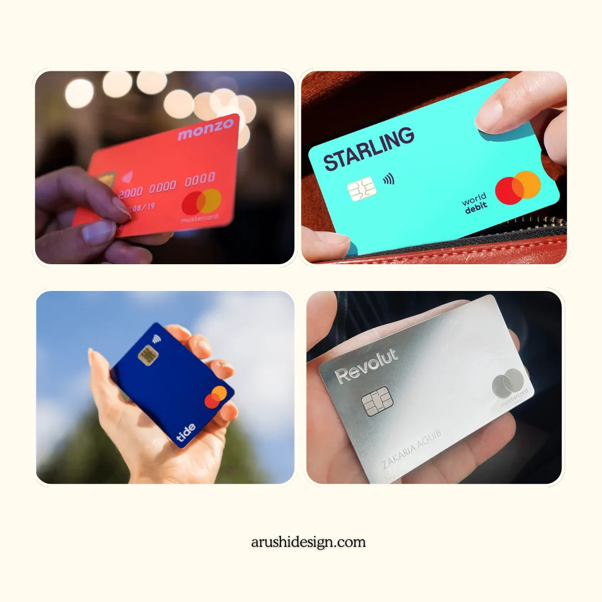
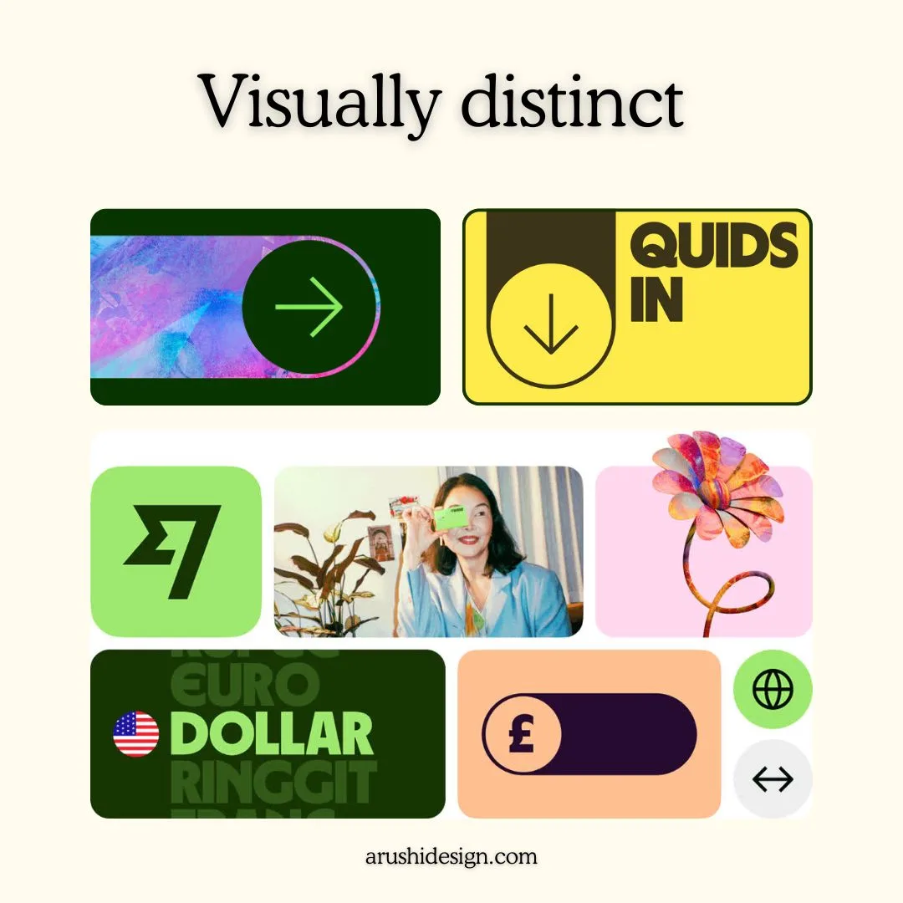
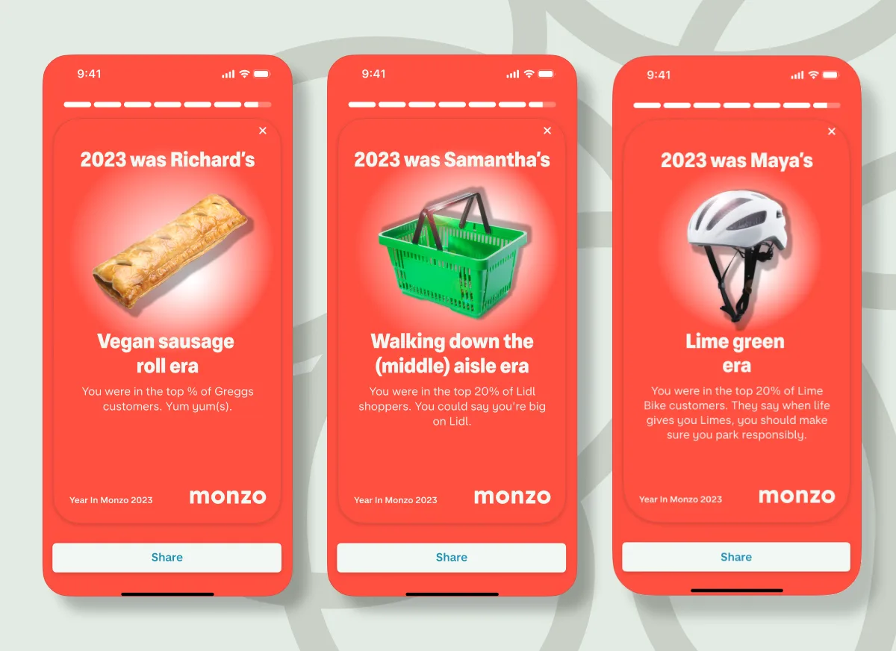
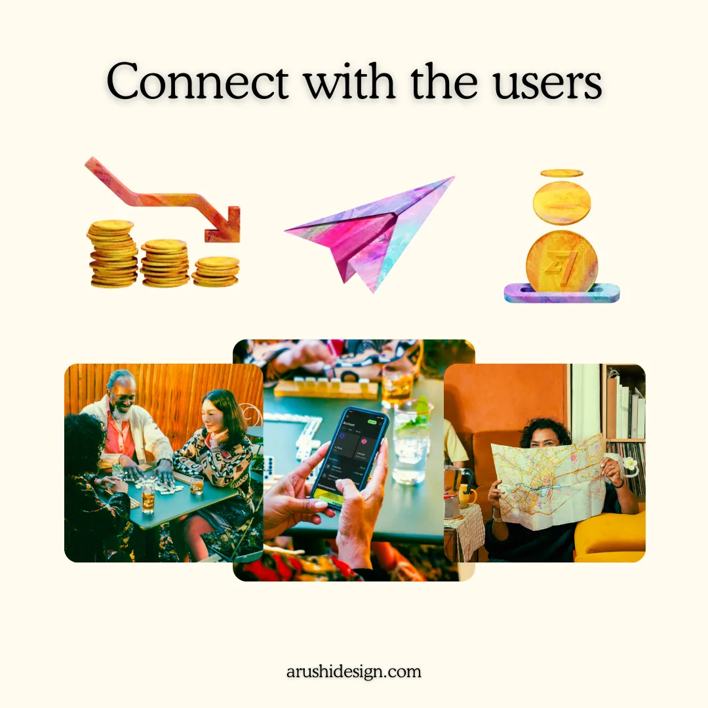

In the bustling world of UK fintech, where new challenger banks and digital platforms seem to launch every week, it’s easy to get lost in the noise. So, what separates the leaders from the rest? Increasingly, it’s not just the features or the fees; it’s the design. 🎨

Let’s dive deeper into how design is helping UK Fintechs carve out their own space, with real examples and ideas for visuals to bring your blog to life.

## 1. Unique Brand Personalities 💫

Your brand personality is your first impression, and in fintech, it can make or break you. Traditional banks often feel cold and corporate, but UK challenger banks have completely flipped the script.

**Monzo** burst onto the scene with its iconic hot coral card. It wasn't just a debit card; it was a conversation starter. The vibrant colour became synonymous with modern, accessible banking. Their friendly, approachable tone, from app notifications to customer service, makes users feel like they're chatting with a helpful friend, not a faceless institution.

**Starling Bank** took a different route with its calming teal palette and sophisticated, professional vibe. They appeal to users who want innovation without the playfulness, targeting small businesses and professionals who value reliability with a modern twist.

**Revolut** positions itself as the tech-savvy traveller's best friend, with sleek metallic cards and a bold, ambitious personality that screams "global citizen." Their brand says: we're not just a bank, we're your financial companion for a borderless world.

## 2. Innovative Interaction Patterns 🔄

The way users interact with your product can be your biggest differentiator. UK fintechs have reimagined every touchpoint to make banking feel intuitive, fast, and even enjoyable.

**Revolut** pioneered instant spending notifications with rich context, not just "you spent £5," but "you spent £5 at Pret A Manger, you have £245 left in your budget this week." This transforms a simple notification into a helpful financial assistant.

**Monzo's** "Pots" feature lets users create virtual savings jars with custom names and goals. Want to save for a holiday in Greece? Create a pot, add a fun emoji, and watch your progress. It gamifies saving in a way that feels personal and motivating.

**Chip** uses AI to analyze spending patterns and automatically save small amounts that users won't miss. The interaction is almost invisible; users just watch their savings grow without thinking about it.

**Plum** takes it further with a chatbot interface that feels like texting a financially savvy friend. "Hey, you could save £50 this week. Want me to do it?" It's conversational, not transactional.

- 
- 

## 3. Distinctive Visual Languages 🎭

Visual language is more than aesthetics; it's communication. The best UK fintechs use design to instantly convey their values and build trust.

**Atom Bank** was the UK's first app-only bank, and its design reflects that pioneering spirit. Clean lines, generous white space, and a minimalist approach signal transparency and simplicity. Every element serves a purpose—no clutter, no confusion.

**Tide**, designed for small businesses, uses bold typography and clear data visualization to help entrepreneurs understand their cash flow at a glance. Their dashboard feels like a command center, empowering users with information.

**Curve** consolidates all your cards into one, and its visual design reflects this simplicity. A unified colour scheme, clear card hierarchy, and smooth animations make complex financial aggregation feel effortless.

**Zopa**, one of the UK's oldest peer-to-peer lenders turned bank, uses warm, approachable visuals with human photography and soft gradients. They balance innovation with trustworthiness—crucial for a brand asking users to lend and borrow money.

## 4. Memorable User Experiences ✨

Great experiences create loyal customers. UK fintechs have mastered the art of making every interaction memorable.

**Monzo's onboarding** is legendary in the industry. From the moment you download the app, you're guided through a seamless journey: verify your identity with a selfie, answer a few questions, and your hot coral card arrives in days. The process feels personal, secure, and surprisingly fun. They even send you updates about where your card is in the delivery process!

**Starling Bank** offers instant account switching, making it painless to leave your old bank. They handle all the admin: direct debits, standing orders, everything, while keeping you informed every step of the way. It removes the biggest barrier to switching: hassle.

**Revolut's** in-app analytics show spending breakdowns by category with beautiful, easy-to-understand charts. Users can see exactly where their money goes each month, making budgeting feel less like homework and more like self-discovery.

**Monese** specializes in serving immigrants and expats who struggle to open UK bank accounts. Their experience is designed with empathy, accepting international IDs, offering multi-language support, and celebrating the diversity of their users. Every touchpoint says "you belong here." 🌍

## 5. Emotional Connection Strategies ❤️

The strongest brands don't just serve customers, they build communities and forge emotional bonds.

**Monzo** has cultivated a passionate community through transparency and inclusion. They share their product roadmap publicly, let users vote on new features, and host community events. When they faced challenges, they communicated openly with users, building trust through vulnerability. Their forum has thousands of active members who feel invested in Monzo's success.

**Starling Bank** connects emotionally through its commitment to social responsibility. They've pledged to be carbon neutral and support local communities. For users who care about ethical banking, this creates a powerful emotional alignment.

**Chip** uses playful language and celebrates savings milestones with confetti animations and encouraging messages. "You're a savings superstar! 🌟" might seem small, but these micro-moments of celebration create positive associations with saving money.

**Dozens** (now closed, but a great example) built an emotional connection through education. They didn't just offer investment products—they taught users about investing through bite-sized lessons, making finance accessible and empowering.

**Freetrade** democratizes investing with zero fees and a mission to "get everyone investing." Their brand voice is encouraging and educational, breaking down the intimidation factor of stock markets. They've built a community of first-time investors who support each other.

## The Bottom Line 💼

In a crowded market, design isn't just decoration, it's strategy. The UK's top fintechs are proving that when you invest in design, you're investing in:

✅ **Recognition** – Stand out in a sea of sameness

✅ **Trust** – Professional design signals reliability

✅ **Loyalty** – Great experiences keep users coming back

✅ **Advocacy** – Delighted users become your best marketers

✅ **Premium positioning** – Good design justifies premium value

Whether you're launching a new fintech or refreshing an existing brand, remember: your competitors can copy your features, but they can't copy your design DNA. Your unique visual language, interaction patterns, and emotional connections are what will make users choose you and stick with you.

Ready to stand out? Make design your differentiator. 🎯

Image credits © Wise Official Website and [https://wise.design/](https://wise.design/)

Monzo

Revolut

Starling Bank

Tide

Overview and Comparison graphics designed by Arushi Design Studio
