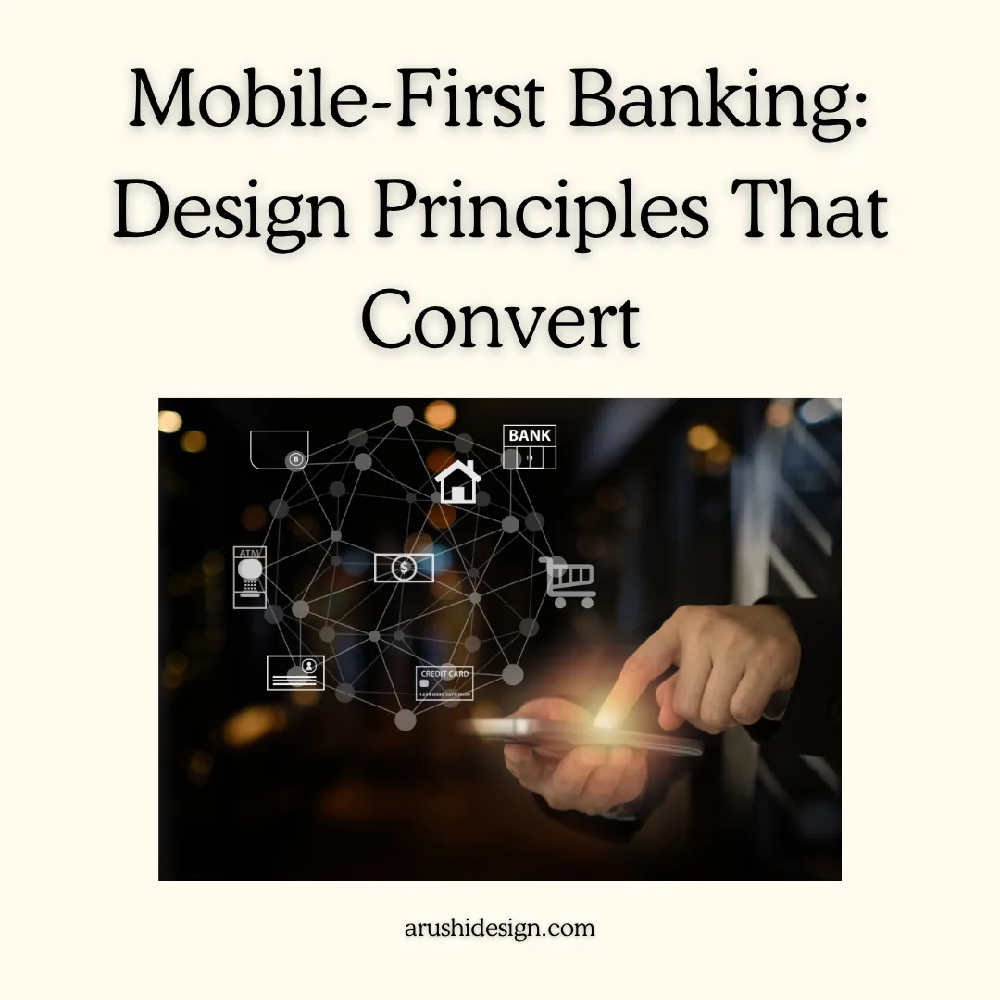
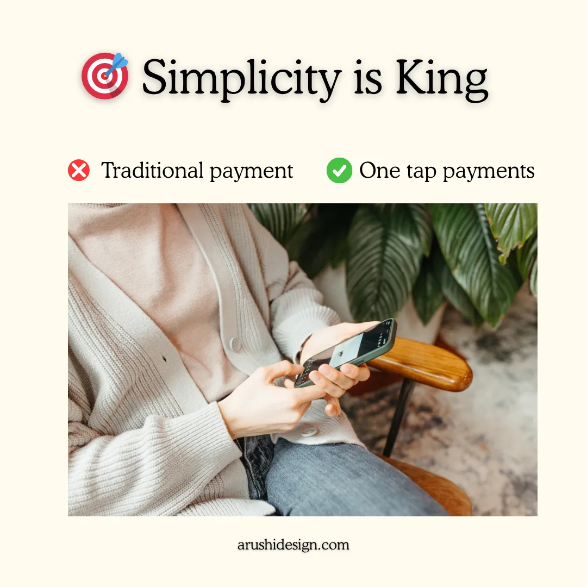
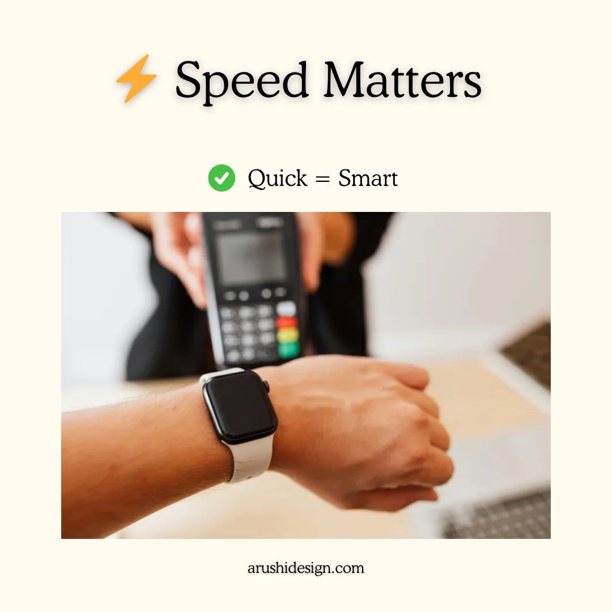

The banking industry has undergone a seismic shift. What was once a sector defined by marble columns and face-to-face interactions is now dominated by pixels, swipes, and biometric authentication. Mobile banking isn't just another channel anymore; it's *the* channel.

But here's the uncomfortable truth: most banking apps are downloaded and quickly forgotten. According to recent studies, the average person uses only 9 apps regularly, and banking apps face fierce competition for that coveted home screen real estate.

So what separates the mobile banking experiences that convert from those that collect digital dust? Let's dive into the design principles that actually move the needle.

## The Mobile-First Mindset: More Than Responsive Design

Mobile-first banking isn't about shrinking your desktop experience to fit a smaller screen. It's about fundamentally rethinking how people interact with their money in a mobile context.

Your users aren't sitting at a desk with a cup of coffee and 20 minutes to spare. They're:

- Standing in line at the grocery store
- Splitting a dinner bill with friends
- Checking their balance on the subway
- Paying a bill while watching TV

Every design decision should acknowledge this reality. Mobile-first means designing for distraction, for one-handed use, for spotty connections, and for users who want to accomplish their task in under 30 seconds.

## Principle 1: Simplicity is Your Competitive Advantage

The best mobile banking apps feel almost empty. Not because they lack features, but because they've mastered the art of progressive disclosure.

**What this looks like in practice:**

- **Clear visual hierarchy** – Your user's balance should be the hero. Everything else is the supporting cast.
- **Task-focused design** – The top 5 actions (check balance, transfer money, pay bills, deposit cheques, view transactions) should be immediately accessible.
- **Minimal form fields** - Every field you ask users to fill out is a conversion barrier. Use smart defaults, autofill, and saved preferences aggressively.

Chase Bank's mobile app exemplifies this principle. Their home screen shows your balance prominently, with quick actions below. Want to do something more complex? It's there, but it doesn't clutter the primary experience.

**The conversion impact:** Reducing steps in a money transfer flow from 6 to 3 can increase completion rates by up to 40%.

## Principle 2: Security That Feels Invisible

Here's the paradox of mobile banking security: users want Fort Knox-level protection, but they also want instant access. The solution? Security that works in the background.

**Modern security UX includes:**

- **Biometric authentication** – Face ID and fingerprint scanning are both more secure and more convenient than passwords
- **Contextual security** - Require additional verification only when behavior seems unusual
- **Transparent fraud protection** – Real-time alerts that inform without alarming
- **Clear security indicators** – subtle visual cues that reassure users their data is protected

Revolut does this brilliantly. Their app uses biometrics by default, provides instant transaction notifications, and allows users to freeze/unfreeze cards with a single tap. Security becomes a feature, not a friction point.

**The trust factor:** 68% of users say they'd switch banks after a security breach. But 73% also abandon apps they find too cumbersome to log into. Balance is everything.

## Principle 3: Speed is a Feature

In mobile banking, speed isn't just about performance—it's about perceived value.

Research from Google shows that 53% of mobile users abandon sites that take longer than 3 seconds to load. For banking apps, where users often have urgent needs, the tolerance is even lower.

**Speed optimisation strategies:**

- **Aggressive caching** – store frequently accessed data locally
- **Optimistic UI** - Show the result immediately, sync in the background
- **Skeleton screens** – give users visual feedback while content loads
- **Offline functionality** – Let users view recent transactions and balances without connectivity

Monzo, the UK digital bank, has built their reputation partly on speed. Transactions appear instantly, transfers complete in seconds, and the app feels responsive even on slower connections.

**The conversion math:** A 1-second delay in page load time can reduce conversions by 7%. For a bank processing millions of transactions, that's real money.

## Principle 4: Design for Thumbs, Not Cursors

Mobile banking happens on the go, which means one-handed use isn't a nice-to-have—it's essential.

**Thumb-friendly design principles:**

- **Bottom navigation** – Primary actions should be within easy thumb reach
- **Large touch targets** – minimum 44x44 pixels, with adequate spacing
- **Gesture support** – Swipe to see more details, pull to refresh, long-press for options
- **Avoid top-corner actions** – these require hand repositioning on larger phones

The "thumb zone" concept, popularised by UX researcher Steven Hoober, shows that the bottom third of the screen is easiest to reach, the middle third requires stretching, and the top third often requires a second hand.

**Real-world application:** Bank of America's mobile app places its most-used features - accounts, transfers, and deposits - in the bottom navigation bar. Less common actions live in the top menu.

## Principle 5: Personalization Drives Engagement

Generic banking apps are forgettable. Personalised banking apps become indispensable.

Modern users expect their banking app to understand their financial life and provide proactive insights.

**Personalisation opportunities:**

- **Smart notifications** – "You're spending 20% more on dining this month."
- **Predictive features** – "You have a $500 bill due in 3 days."
- **Custom dashboards** – Let users prioritize what they see first
- **Contextual offers** - Relevant products based on actual behavior, not demographics

Citi's mobile app uses AI to analyse spending patterns and provide personalised insights. Users can set spending goals, track progress, and receive alerts when they're approaching limits.

**The engagement multiplier:** personalised experiences can increase user engagement by up to 74% and improve customer satisfaction scores by 20%.

## Principle 6: Accessibility is Inclusivity (and Good Business)

Accessible design isn't just about compliance—it's about serving your entire customer base effectively.

Consider that:

- 15% of the global population has some form of disability
- Temporary impairments (broken arm, bright sunlight) affect everyone
- Accessible design often improves usability for all users

**Accessibility essentials:**

- **Screen reader compatibility** – Proper labeling and semantic HTML
- **High contrast modes** – for users with visual impairments
- **Voice commands** – "Check my balance" should work
- **Adjustable text sizes** – without breaking layouts
- **Alternative authentication** – Not everyone can use biometrics

Capital One's mobile app includes robust accessibility features, including full VoiceOver support, high contrast mode, and the ability to navigate entirely via keyboard commands.

**The business case:** The global market of people with disabilities represents $13 trillion in disposable income. Accessible design isn't charity—it's smart business.

## Bringing It All Together: The Conversion Framework

Great mobile banking design isn't about implementing these principles in isolation—it's about orchestrating them into a cohesive experience.

**The conversion funnel in mobile banking:**

1. **Discovery** – User downloads your app (marketing's job)
2. **Onboarding** - The user creates an account and links funding (simplicity + security)
3. **First value** – User completes their first meaningful action (speed + simplicity)
4. **Habit formation** - User returns regularly (personalization + speed)
5. **Advocacy** - User recommends to others (all principles working together)

Each principle supports different stages of this funnel, but they all contribute to the ultimate goal: converting downloads into daily active users.

## Conclusion: Design is Strategy

In the mobile-first era, your app isn't just a product—it's your brand, your customer service, and your competitive moat all rolled into one.

The banks winning in mobile aren't necessarily the ones with the biggest budgets or the most features. They're the ones who've internalised a fundamental truth: in mobile banking, design isn't decoration. It's a strategy.

Every pixel, every animation, every micro-interaction is either building trust and driving conversion or creating friction and losing customers.

The question isn't whether to invest in mobile-first design. The question is whether you can afford not to.

**What's your experience with mobile banking apps? What features do you find most valuable, and what frustrations do you still encounter? Share your thoughts in the comments below.**
