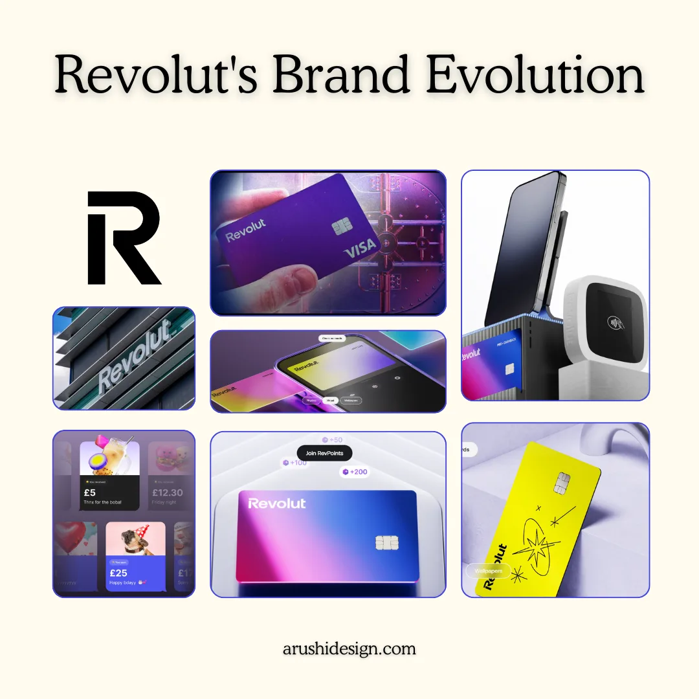
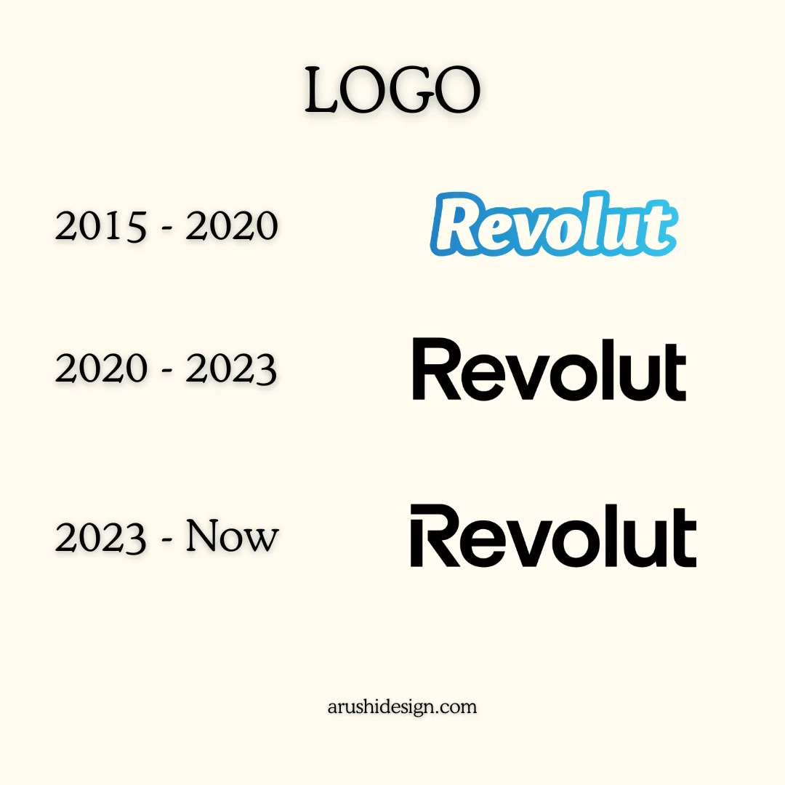
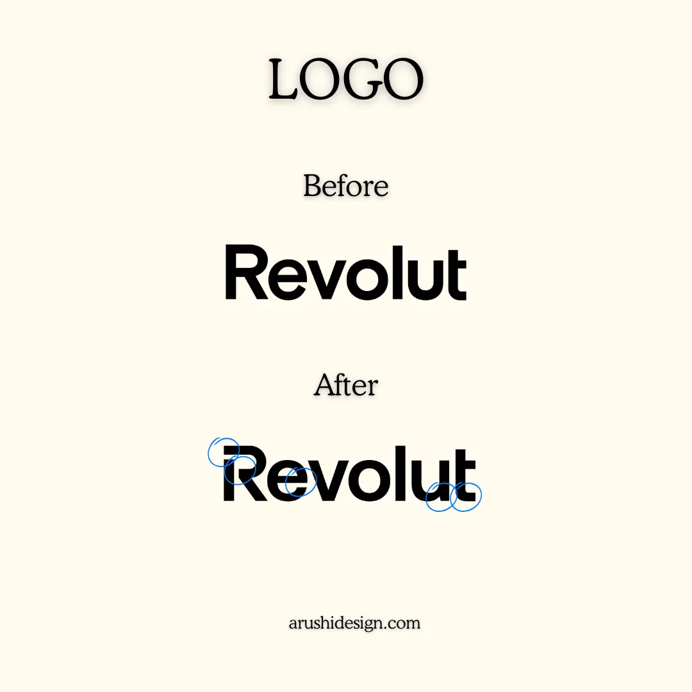
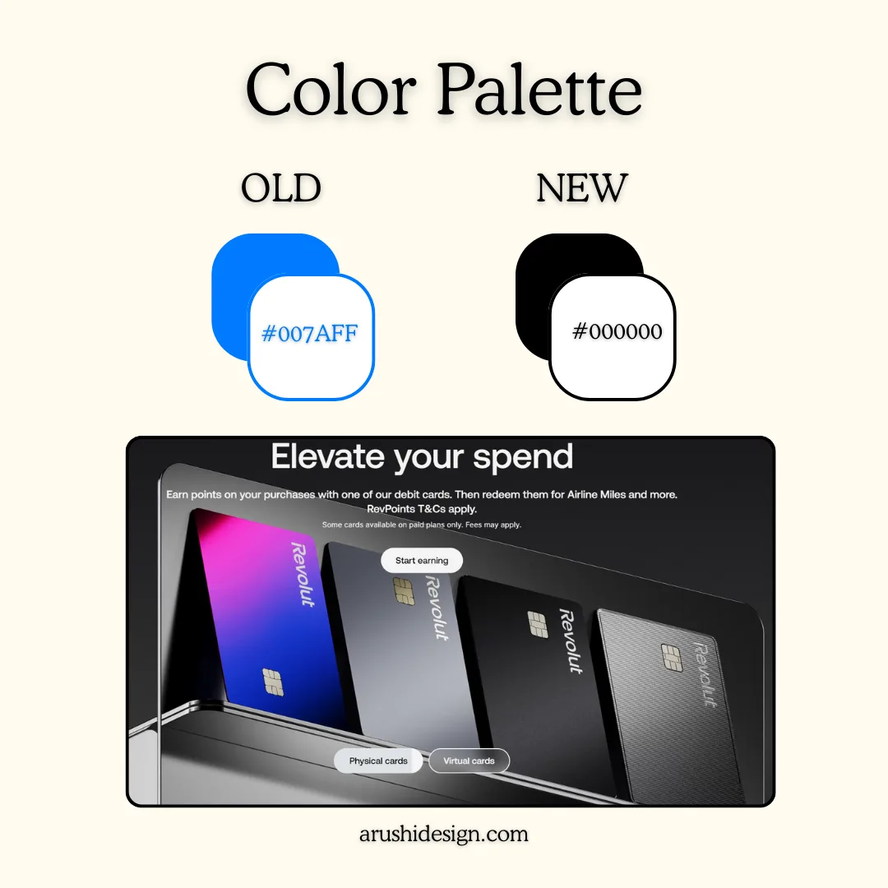
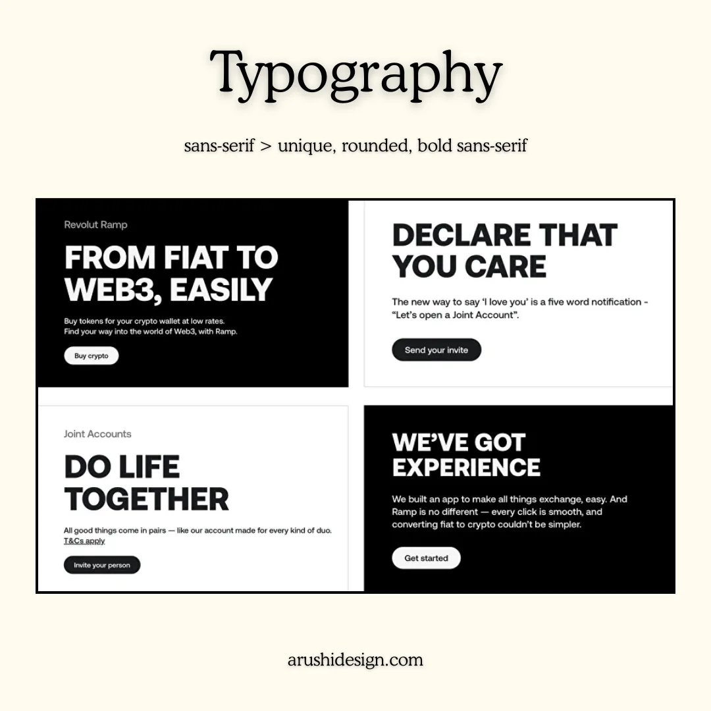
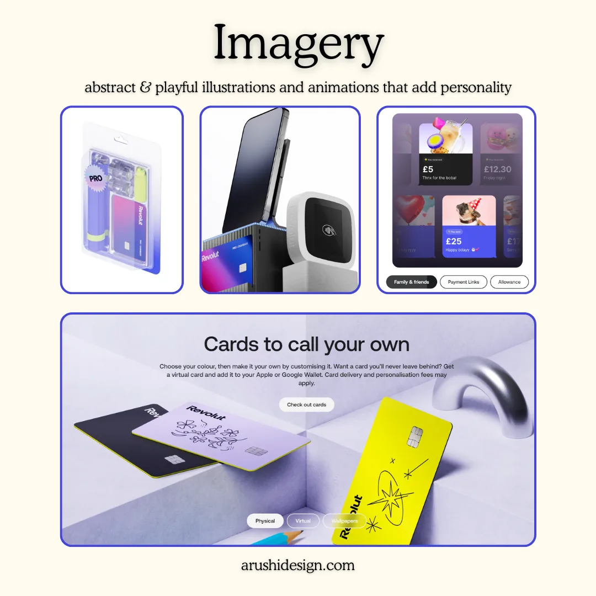
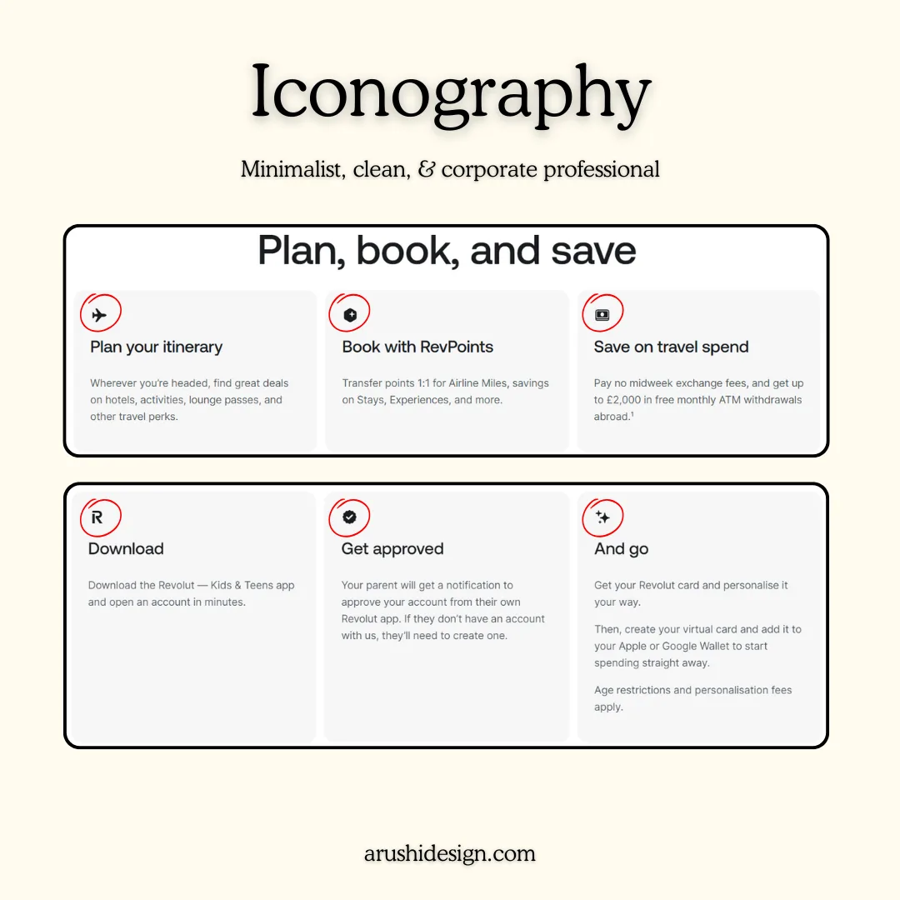

Revolut has undergone a significant brand redesign, moving from its earlier, more utilitarian aesthetic to a bolder, more playful, and distinctly modern identity. This evolution reflects not only the company's growth but also a strategic shift to appeal to a broader, yet still digitally-native, audience.

Revolut, a trailblazer in digital banking, offers a compelling case study in brand evolution, having undergone a significant redesign that moved it from a utilitarian challenger to a vibrant, lifestyle-oriented financial companion.

Let's take a closer look at this fascinating transformation, comparing the "Old Revolut" with the "New Revolut" across key branding elements.

When Revolut first emerged, its brand identity reflected its mission: to disrupt traditional banking with efficiency, transparency, and a digital-first approach.

**Logo & Iconography:** The earlier Revolut logo often featured a more conventional "R" icon. It was *clean, professional, and straightforward*, sometimes incorporating subtle gradients but generally leaning towards a more *corporate aesthetic*. The focus was on clear identification rather than expressive design. The current "R" logo is a dramatic departure. It's highly stylized, often rendered in a vibrant, multi-color gradient that feels energetic, futuristic, and instantly recognizable. This dynamic logo is a visual metaphor for the diverse and evolving services Revolut now offers.

**Color Palette:** This is perhaps the most striking change. The brand exploded into a diverse and vibrant spectrum. Gradients are heavily utilized, creating a sense of dynamism and modernity. The dominant colors were typically a cool, professional blue - close to [#007AFF](https://www.arushidesign.com/blog/hashtags/007AFF) and crisp white. This palette, reminiscent of established financial institutions but with a modern twist, aimed to convey *reliability, trust, and efficiency*. The lack of extensive color variation underscored its no-frills, functional promise.

**Typography:** Readability and clarity were paramount. Sans-serif fonts were used, prioritizing a clean and easy-to-navigate user interface. The typography was functional, not overtly distinctive. While still clean, there's a greater emphasis on unique, rounded, and often bold sans-serif fonts. These choices convey approachability, innovation, and a distinct personality, making the brand feel more human and less purely transactional.

**Imagery & Illustrations:** The new brand heavily incorporates abstract, often playful illustrations and animations. These elements add personality, make complex financial concepts more digestible, and enhance the overall user experience, contributing to a more engaging and less intimidating financial journey.

**Overall Vibe:** The brand communicated competence, efficiency, and a direct challenge to the status quo. It was about getting the job done simply and effectively, appealing to early adopters who valued functionality and a streamlined experience above all else. The new Revolut brand is innovative, vibrant, and user-friendly. It communicates a lifestyle brand that offers more than just banking – it's a financial companion that understands and enhances the digital lives of its users. It aims to build an emotional connection, fostering loyalty and a sense of belonging.

The Old Revolut: Functional, Minimalist, and Disruptive

The New Revolut: Expressive, Dynamic, and Lifestyle-Oriented

## Why This Evolution Matters

Revolut's brand redesign is more than just a fresh coat of paint. It's a strategic move to:

- **Broaden Appeal:** Attract a wider audience beyond early tech adopters.
- **Reflect Product Expansion:** Visually communicate its diverse range of services.
- **Enhance Emotional Connection:** Build deeper loyalty through a more engaging and relatable brand.
- **Maintain Competitive Edge:** Stand out in an increasingly crowded fintech market.

By embracing a more expressive and visually engaging identity, particularly through its bold and dynamic color palette, Revolut has successfully repositioned itself as a leading lifestyle financial app, ready for the next phase of digital banking.

Image credits © Revolut Official Website

Overview and Comparison graphics designed by Arushi Design Studio
